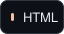
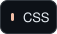
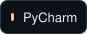
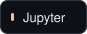

<!-- Profile README for muhammad-aseem. SVG motion uses SMIL; no scripts or embedded CSS. -->

  

  

## About Me

I'm **Muhammad Aseem**, a **BSc Computing student** interested in Python development, backend engineering, artificial intelligence, and web development.

I have frontend web development experience from my internship at **Waan Tech**. I'm now strengthening my Python foundations and learning how to build applications beyond the browser.

<b>More about my background</b>

My practical experience is in frontend web development. Python, machine learning, and backend engineering are areas I am actively learning and developing toward.

## Technical Skills

**Programming and web languages**

  
  
  
  

**Frontend frameworks and CSS tooling**

  
  
  

## Development Tools and IDEs

**Version control and development platforms**

  
  

**IDEs and editors**

  
  

**Notebook environment**

  

## Currently Learning / Career Direction

- **Python:** strengthening fundamentals and problem-solving skills.
- **Backend development:** learning Flask, SQL, and APIs.
- **Machine learning:** studying supervised and unsupervised learning fundamentals.

I'm working toward a career in **Python and backend development**, with a longer-term interest in building AI-powered applications.

<b>What I want to build toward</b>

I'm interested in connecting clean web interfaces to Python backends, understanding how applications store and exchange data, and learning where AI can solve practical problems.

These are learning goals and career interests, rather than claims of professional expertise.

## Live GitHub Contribution Streak

  

  Updates automatically from my GitHub contribution history. <a href="https://github.com/DenverCoder1/github-readme-streak-stats">Powered by GitHub Readme Streak Stats.</a>

## Connect With Me

Explore my code and follow my learning journey on GitHub.

