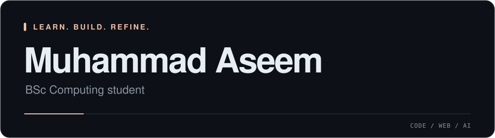

<!-- Profile README for muhammad-aseem. SVG motion uses SMIL; technology icons are hosted in this repository. -->

  

  

## About Me

I'm **Muhammad Aseem**, a **BSc Computing student** interested in software development, programming languages, backend engineering, artificial intelligence, and web development.

**Python is my favourite programming language.** I enjoy expanding my programming skills and exploring different ways to build software.

I have frontend web development experience from my internship at **Waan Tech**. I'm now strengthening my programming foundations and learning how to build applications beyond the browser.

<b>More about my background</b>

My practical experience is in frontend web development. I'm developing my programming foundations while learning backend engineering and machine learning.

## Technical Skills

**Programming languages**

  
  &nbsp;
  

**Web technologies**

  
  &nbsp;
  

## Development Tools and IDEs

**Version control and development platforms**

  
  &nbsp;
  

**IDEs and editors**

  
  &nbsp;
  

## Currently Learning / Career Direction

- **Programming:** strengthening Python and JavaScript fundamentals and problem-solving skills.
- **Backend development:** learning Flask, SQL, and APIs.
- **Machine learning:** studying supervised and unsupervised learning fundamentals.

I'm working toward a career in **software development and backend engineering**, with a longer-term interest in building AI-powered applications.

<b>What I want to build toward</b>

I'm interested in connecting clean web interfaces to backends, understanding how applications store and exchange data, and learning where AI can solve practical problems.

These are learning goals and career interests, rather than claims of professional expertise.

## Live GitHub Contribution Streak

  

  Updates automatically from my GitHub contribution history. <a href="https://github.com/DenverCoder1/github-readme-streak-stats">Powered by GitHub Readme Streak Stats.</a>

## Connect With Me

Explore my code and follow my learning journey on GitHub.

